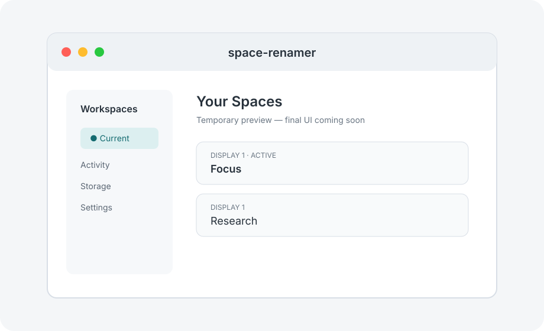
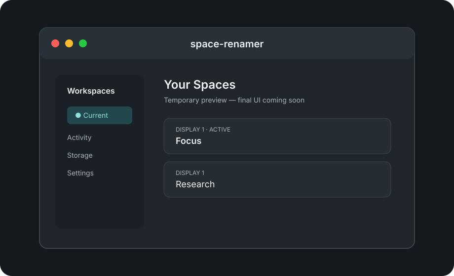

# workspace-renamer

Local-first tools for giving macOS desktop Spaces names that are easier to recognize.

## macOS Workspace Renamer

[`space-renamer`](https://github.com/workspace-renamer/macos-workspace-renamer) is a native macOS menu bar app for naming and identifying Spaces across displays. It includes a focused workspace editor, active-Space indicators, minimal settings, local JSON storage, and an AppKit interface designed around the shared UI direction for this organization.

The app is built with Swift and AppKit. It has no third-party runtime dependencies, network service, telemetry, updater, or cloud account requirement. Names remain on the Mac and are associated with Space identities rather than desktop positions.

### Preview

These are temporary product-preview placeholders. Replace them with approved screenshots after the UI and final app icon are complete.

<table>
  <tr>
    <td></td>
    <td></td>
  </tr>
  <tr>
    <td align="center">Light mode placeholder</td>
    <td align="center">Dark mode placeholder</td>
  </tr>
</table>

### Repositories

- [Development repository](https://github.com/workspace-renamer/macos-workspace-renamer-dev) — implementation, tests, issues, pull requests, and release candidates.
- [Official releases](https://github.com/workspace-renamer/macos-workspace-renamer) — reviewed source promotions and authorized end-user releases.

The official product repository is currently private.

### Project principles

- Keep the app local and dependency-light.
- Keep private macOS API access isolated and read-only.
- Preserve user data during Space reordering, display changes, and detection failures.
- Validate builds and packages locally before promotion to the official repository.
- Treat screenshots and icon artwork as replaceable product assets while the UI is being finalized.
